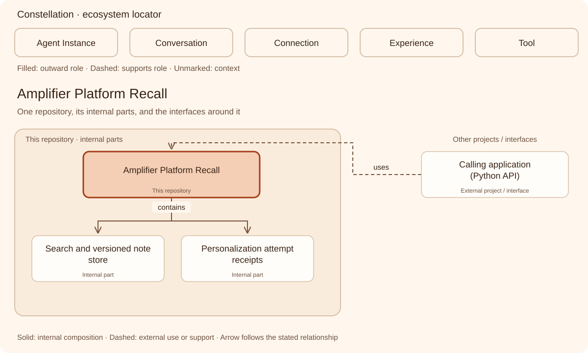

# Recall and memory storage

`amplifier_recall` stores derived conversation search data and explicit, versioned
memory records in a caller-selected SQLite database. Its existing imports are
unchanged: `RecallStore`, `amplifier_recall.store` and
`amplifier_recall.personalization`. It uses Python's standard library and SQLite
FTS5/JSON functions; it does not need Unified, Core, Foundation or a provider.

The caller supplies source records and allowed source IDs, verifies originals
before using recalled text, and owns authorization, scope and retention policy.
The store owns indexing, paging, note revisions, compare-and-swap mutations and
command receipts. Its transactions, database schema, private file permissions,
WAL and secure-delete behavior are unchanged.

The database is not all disposable index data: explicit notes, their retained
versions, settings, command receipts and suppression records are durable.
`Personalization` tracks caller-admitted attempts; constructing it marks
unconfirmed claims interrupted without replaying them. It never schedules a
model call. Unified retains opt-ins, source eligibility, context assembly,
model execution and Stop. The separate `amplifier-bundle-memory` package continues
to own extraction, quotation verification and relevance; this package does not
replace those mechanisms or native history.

## Ecosystem map

[Project overview](https://microsoft.github.io/amplifier-constellation/projects/amplifier-platform-recall/) ·
[Open the map](https://github.com/bkrabach/amplifier-platform-recall/blob/main/docs/ecosystem-map.svg) ·
[Map guide](https://github.com/microsoft/amplifier-constellation/blob/main/docs/ecosystem-maps.md)



<details>
<summary>The wider Constellation ecosystem</summary>


</details>

These maps are generated from the [canonical registry](https://github.com/microsoft/amplifier-constellation/blob/main/docs/ecosystem/registry.json).
Update that source and refresh the local maps together; a map is not a release or compatibility claim.

## Develop and qualify

Use Python 3.13 or newer with SQLite FTS5/JSON support. From this directory:

```sh
uv run --extra test pytest
uv build
```

The source distribution includes these tests. For installed qualification, install
the wheel with its `test` extra into a separate environment without Unified, Core
or Foundation. Copy `tests/` and `pyproject.toml` outside this source checkout and
run that environment's `python -I -m pytest` there. Check that imports resolve to
the installed package. The tests cover full-library lexical ranking and scope,
durable note/receipt recovery, rollback and interrupted-attempt handling. They do
not establish host permissions, model behavior or native history compatibility.
The host tests remain in Unified's `tests/test_recall.py` and
`tests/test_memory_personalization.py`.

## Ownership and provenance

This history-preserving project is prepared as the public author home at
`bkrabach/amplifier-platform-recall`, with a later transfer to Microsoft planned.
[PROVENANCE.json](PROVENANCE.json) records the original public Unified source,
pre-move history, and exact imported runtime/test bytes. Original MIT attribution
is preserved. The repository name does not rename the `amplifier-recall`
distribution or `amplifier_recall` import.

This import changes no runtime behavior, dependency requirement, package version,
or maintained test. Unified retains its host integration and policy. Authoring
handoff and consumer selection are separate reviewed changes; retire Unified’s
authored project at handoff rather than maintain two authoring copies.

Foundation also carries an optional `libraries/recall` package with different
bounded indexing/query/version APIs. This imported line retains Unified’s
`Personalization` and receipt-provenance behavior. Neither line replaces the other
through this move; a later consolidation needs an explicit API and consumer review.

Use a separate environment for this distribution. Do not coinstall it with
`amplifier-unified`, which currently owns its selected `amplifier_recall` files.
This source import is not independent pip replacement inside a Unified prefix.

## Existing delivery and future publication

Unified continues to select the immutable [recall-v0.1.0 artifacts](https://github.com/microsoft/amplifier-unified/releases/tag/recall-v0.1.0)
from their original public producer. The original source receipt, revision,
subdirectory and hashes remain historical identities; this repository does not
republish or relabel those artifacts. Unified’s generated `components/recall-delivery/`
is selected by `components/recall.source.json` and verified offline during
normal builds. Do not edit that generated copy by hand.

The [package workflow](.github/workflows/package.yml) builds one wheel and source
archive, then tests that wheel outside the checkout. It does not publish a release
or change any consumer. A future publication needs an exact source/artifact
receipt and review of Unified’s selector for this repository-root project layout;
the existing selector identifies historical monorepo subdirectories. Source moves
do not reserve a new version or make the original receipts invalid.

## Project guidance

The original MIT license and Microsoft open-source conduct, security and support
guidance are retained for this eventual Microsoft home. This repository is
currently hosted under `bkrabach`; it does not claim Microsoft organization
automation, CLA enforcement, release service connections or support coverage.
The existing security-reporting guidance is retained; do not post vulnerabilities
in public issues.
